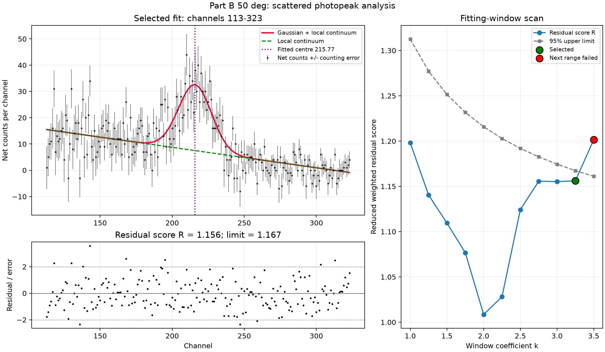

# Compton-scattering spectrum analysis

This notebook analyses scattered-photon spectra from my two-person PHAS0051 laboratory experiment. I set up the apparatus and wrote the analysis code. It accepts a scattering angle, subtracts a separately measured background, and fits the scattered photopeak with a Gaussian plus a local linear continuum.

## Included files

- `PartB_Adaptive_Fit_Angle_Input_FIXED.ipynb`: the original notebook, copied without editing its code or metadata.
- `40_degree_20min.txt`, `50_degree_20min.txt`, `60_degree_20min.txt`: measured signal spectra, each acquired for 1,200 seconds.
- `partb_background_10min.txt`: the 600-second background spectrum.
- `examples/`: plots and console logs from running the notebook on those three angles.

This directory covers Part B peak analysis. The Part A calibration fit is not included; its coefficients are used in the notebook.

## Run

From the repository root:

```sh
python -m pip install -r compton_scattering/requirements.txt
cd compton_scattering
python -m notebook PartB_Adaptive_Fit_Angle_Input_FIXED.ipynb
```

Run the code cell and enter `40`, `50` or `60` when prompted. Each run saves `partb_<angle>deg_analysis.png` alongside the notebook. Starting Jupyter in this directory keeps the relative data paths valid.

## Analysis

The notebook scales the background by the acquisition-time ratio and propagates signal and background counting errors. It excludes the known anomalous last channel consistently from all arrays. A smoothed spectrum is used to locate a candidate peak; fitting uses the unsmoothed background-subtracted counts and their uncertainties.

Candidate peaks are searched within ±40 channels of the expected Compton energy, then chosen by prominence. The method therefore uses theory to guide peak identification. It should not be interpreted as a blind peak search or an independent test of the Compton formula.

The fit window is expanded and checked using a reduced weighted residual score and a residual-sign runs diagnostic. The selected fit, normalised residuals and window scan are plotted together.

| Angle | Fitted centre (channel) | Energy (keV; fit error only) | Selected window factor |
| --- | ---: | ---: | ---: |
| 40° | 238.921 ± 0.800 | 501.01 ± 1.80 | 4.00 |
| 50° | 215.769 ± 0.898 | 448.89 ± 2.02 | 3.25 |
| 60° | 192.728 ± 0.815 | 397.02 ± 1.84 | 4.00 |



## Interpretation and uncertainty

The calibration used here is `E = 2.2513 × channel − 36.87` keV. The displayed energy errors propagate only the fitted peak-centre uncertainty. A complete uncertainty budget would also need the slope/intercept covariance and experimental contributions such as angle uncertainty. The separate calibration-error constants in the code are not combined into the displayed error bar.

The 40° and 60° fits reach the maximum tested window factor of 4. Passing the internal diagnostics at that boundary does not establish an optimal window. The diagnostics also follow a data-dependent window search, so their nominal thresholds do not directly provide a final 95% coverage or peak-detection significance. The console output retains these qualifications.

The example plots were regenerated on 2026-11-06 from the included measurements; they are demonstrations of the existing notebook, not new experimental acquisitions.
