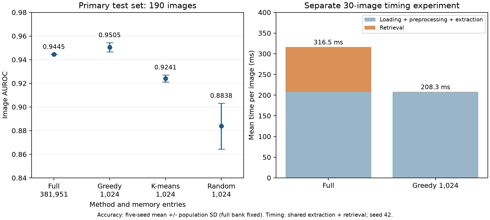

# Textile anomaly detection under a memory budget

Code and saved results for my sole-author manuscript, submitted to *Engineering Applications of Artificial Intelligence* in October 2026 (under review).

I compared three ways of compressing a patch-feature memory: greedy farthest-point selection, MiniBatchKMeans centres and random sampling. All use the same DINOv2 features and cosine nearest-neighbour image score.

## Main experiment

- 279 normal training images; 190 test images (59 normal, 131 defective).
- DINOv2 ViT-B/14, 518 × 518 input, final-block spatial tokens with CLS removed.
- 1,369 L2-normalised, 768-dimensional float32 vectors per image.
- Full memory: 381,951 vectors. Compact memories: 1,024 vectors.
- Image score: mean of the largest `max(1, floor(0.01 P))` patch distances, hence **13** for `P = 1,369`.
- Compact methods use selection seeds 42, 123, 456, 789 and 1024.

| Memory | Stored features (MB) | Image AUROC |
| --- | ---: | ---: |
| Full, 381,951 entries | 1,173.35 | 0.9445 |
| Greedy, 1,024 entries | 3.146 | 0.9505 ± 0.0039 |
| K-means, 1,024 entries | 3.146 | 0.9241 ± 0.0030 |
| Random, 1,024 entries | 3.146 | 0.8838 ± 0.0194 |

Values after ± are population standard deviations across five selection seeds; the full bank is fixed. MB means decimal megabytes of the stored feature matrix.

The greedy−k-means AUROC difference is 0.0264, with a paired bootstrap 95% interval of [0.0054, 0.0522]. The greedy−full interval is [−0.0077, 0.0217].



## Check the saved results on a CPU

From the repository root:

```sh
python -m pip install -r textile_anomaly_detection/requirements.txt
python textile_anomaly_detection/analyze_results.py
python textile_anomaly_detection/plot_results.py
```

The analysis checks sample IDs and labels against the manifest, reconstructs every image score from its top 13 patch distances, and recomputes AUROC and AP. It then draws 2,000 stratified image-bootstrap samples using seed 20261022. Each sampled set is shared across methods and selection seeds; seed-level AUROCs are averaged within a replicate, with the training set and split held fixed. This reproduces the original bootstrap.

Generated reports go to `reports/`. The bundled `saved_results/` files are read-only inputs to this analysis.

## Files and result provenance

| File | Purpose |
| --- | --- |
| `extract_patch_features.py` | Read the image ZIP and manifest, check image hashes, and cache CLS-free DINOv2 patches |
| `evaluate_patch_memory.py` | Build and score full/compact memories; save aligned image and patch scores |
| `analyze_results.py` | Recompute the bundled primary comparison and paired uncertainty on a CPU |
| `benchmark_end_to_end.py` | Time shared feature extraction and separate full/compact retrieval |
| `plot_results.py` | Draw the primary comparison from recomputed metrics and archived timing |
| `saved_results/manifest.csv` | Original image split, archive-relative filenames, dimensions and hashes; validation rows are retained |
| `saved_results/results/` | Full-bank result plus three methods × five seeds at 1,024 entries: JSON metrics and NPZ scores |
| `saved_results/feature_protocol.json` | Saved model, checkpoint hash, preprocessing and software/hardware versions |
| `saved_results/end_to_end_benchmark.json` | Original timing measurements, image IDs and protocol |

The archived results come from `run_20261022_v1`. JSON/NPZ files, the manifest and feature protocol were copied without changing their contents. The timing JSON also includes a CLS/global-token ablation; the portable timing script focuses on the patch-memory comparison. `analyze_results.py` analyses the bundled 1,024-entry comparison.

The root-level [`memory_compression.py`](../memory_compression.py) is a smaller algorithm example. Its NumPy scoring routine is separate from the GPU research implementation here.

## GPU computation and timing

Greedy selection and cosine retrieval use standard PyTorch GPU operations. Retrieval processes query patches (512) and memory vectors (16,384) in blocks, keeping the full bank on the GPU without forming the full patch-by-memory similarity matrix. K-means is fitted with scikit-learn on the CPU and its centres are moved to the GPU for scoring.

Timing used an RTX 4060 Laptop GPU, 30 balanced test images and three passes, with the first pass discarded (greedy seed 42). Loading, preprocessing and DINOv2 extraction took 207.35 ms per image. Full and compact retrieval took 109.19 and 0.95 ms, giving totals of 316.54 and 208.30 ms: retrieval was about 114× faster, but extraction plus retrieval only 1.52× faster.

The `retrieval_ms_per_image` field in each result JSON comes from the evaluation run and also includes loading cached features; use `end_to_end_benchmark.json` for the comparison above.

## Rerun from images

A full image rerun requires the matching image archive and the official DINOv2 ViT-B/14 checkpoint identified in `feature_protocol.json`. These inputs and the feature caches are not bundled.

The recorded environment was Python with PyTorch 2.7.1+cu128, torchvision 0.22.1+cu128, timm 1.0.25, NumPy 1.26.4 and Pillow 10.3.0. Install a CUDA-enabled PyTorch build matching your system; `requirements-gpu.txt` lists the remaining experiment dependencies and versions.

Create a new run directory and copy the manifest there. For example, in PowerShell from the repository root:

```powershell
New-Item -ItemType Directory -Force textile_anomaly_detection/runs/primary
Copy-Item textile_anomaly_detection/saved_results/manifest.csv textile_anomaly_detection/runs/primary/manifest.csv
python -m pip install -r textile_anomaly_detection/requirements-gpu.txt
python textile_anomaly_detection/extract_patch_features.py --run-dir textile_anomaly_detection/runs/primary --archive D:/datasets/annotations_dataset.zip --weights D:/models/dinov2_vitb14_pretrain.pth
python textile_anomaly_detection/evaluate_patch_memory.py --run-dir textile_anomaly_detection/runs/primary
python textile_anomaly_detection/benchmark_end_to_end.py --run-dir textile_anomaly_detection/runs/primary --archive D:/datasets/annotations_dataset.zip --weights D:/models/dinov2_vitb14_pretrain.pth
```

Replace the two input paths with your own. Evaluation defaults to all three compact methods, five seeds and 1,024 entries, plus the full bank. The GPU scripts were adapted from the original run, with local paths replaced by command-line arguments, and have not been rerun since. The evaluator reuses existing results; use a new run directory for a fresh run.

## External validation summaries

`saved_results/external_validation/` contains archived summaries from the same study, kept separate from the primary experiment:

- **MVTec AD:** 15-category macro image AUROC of 0.9881 ± 0.0014 across five seeds at 1,024 entries (`mvtec_summary.json`).
- **AITEX:** six eligible target fabrics, with greedy own-fabric macro AUROC 0.8573. The paired own-minus-other-fabric gap is 0.27625, giving cross-fabric macro AUROC about 0.5810 (`aitex_methods_summary.json`, `aitex_transfer_summary.json`).
- On target fabric 01, source-calibrated thresholds have mean false-positive rate 0.7370.

AITEX foreground filtering was chosen after examining initial outputs, so these are exploratory results. Source thresholds use only eight or nine held-out normal images, and threshold metrics are descriptive. External validation is supplied as archived summaries; the CPU reproduction commands above cover the primary experiment.
